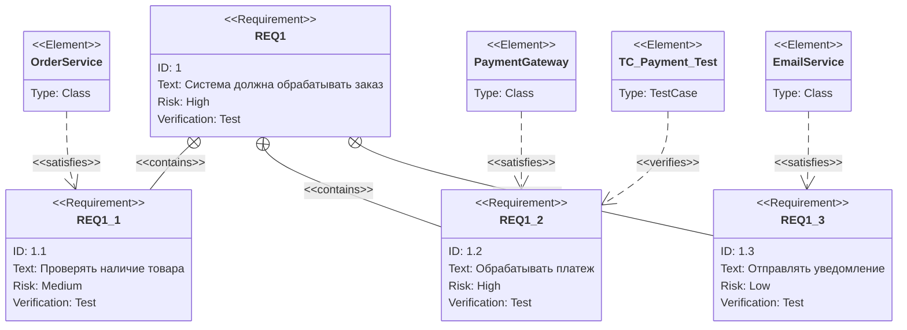
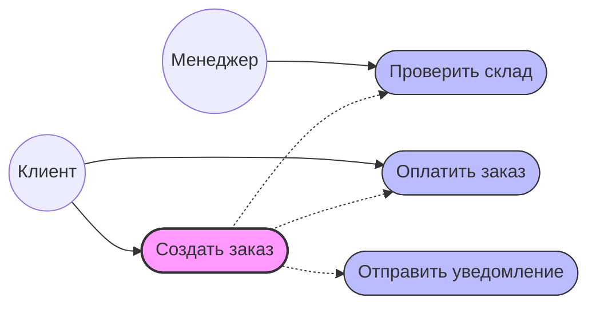
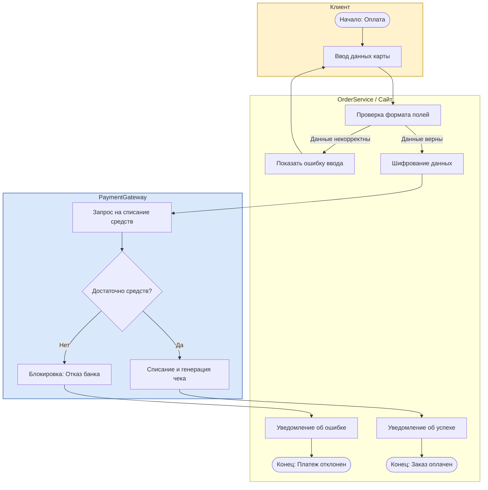
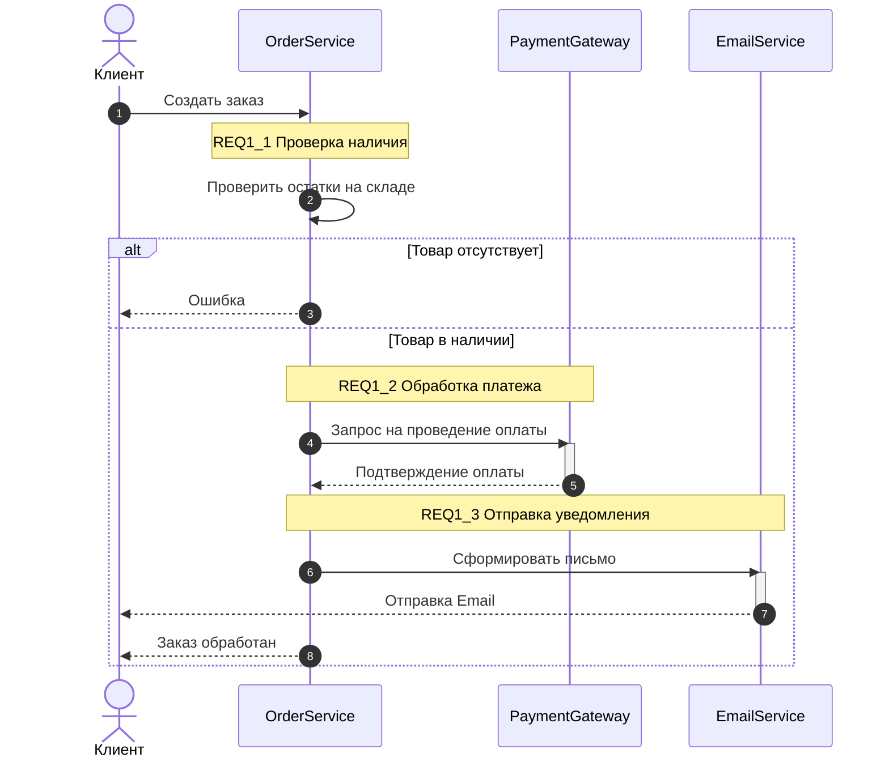
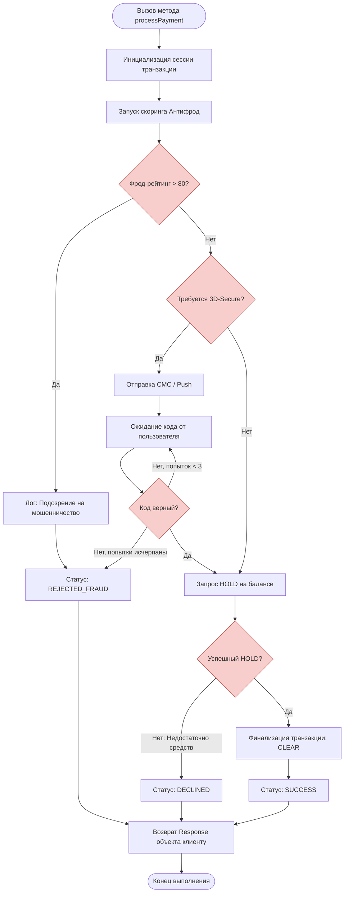

# Материалы курса "Технологии программирования"
# Архитектурное описание системы обработки заказов (Order Processing System)

Данный документ содержит техническую спецификацию и архитектурные диаграммы системы в концепции MBSE (Model-Based Systems Engineering) на базе стандартов **SysML / UML**. Все диаграммы интерактивны и рендерятся нативно средствами GitHub (Mermaid.js).

---

## 1. Спецификация требований (Requirement Diagram)

Диаграмма определяет структуру требований к системе, уровень их критичности (риски) и трассировку до конкретных компонентов архитектуры и тест-кейсов.

---

## 2. Границы системы и прецеденты (Use Case Diagram)

Диаграмма вариантов использования определяет внешних актеров и ключевые функции системы, которые декомпозируют верхнеуровневое требование `REQ1`.

---

## 3. Бизнес-процесс обработки платежа (Activity Diagram)

Диаграмма верхнего уровня (Бизнес-абстракция) для требования `REQ1.2`. Показывает распределение ответственности между Клиентом, Системой и Банком.

---

## 4. Динамическое взаимодействие компонентов (Sequence Diagram)

Пошаговый технический сценарий обработки успешного заказа. Описывает взаимодействие между классами, заявленными в структуре требований.

---

## 5. Детальный алгоритм шлюза (Low-Level Activity Diagram)

Детализация работы низкоуровневой логики компонента `PaymentGateway`. Данный алгоритм покрывается тестами класса `TC_Payment_Test`.

