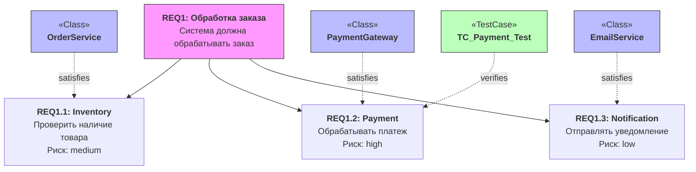
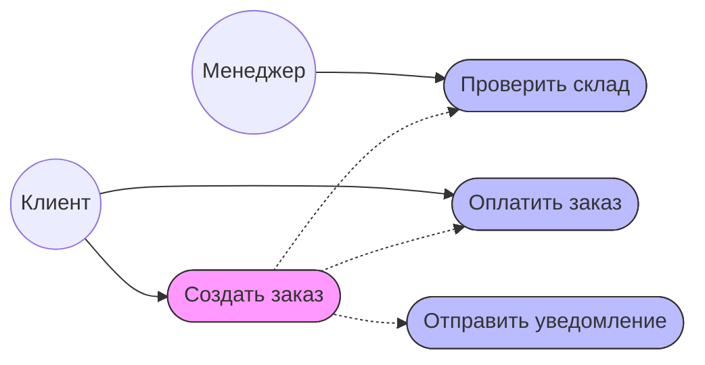
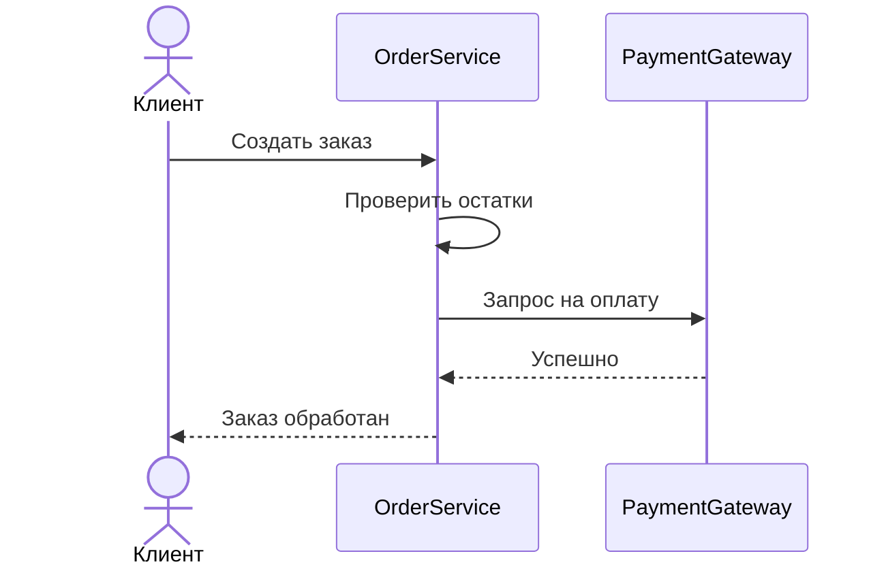

# Материалы курса "Технологии программирования"
# Архитектурное описание системы обработки заказов (Order Processing System)

Данный документ содержит техническую спецификацию и архитектурные диаграммы системы. Все диаграммы интерактивны и рендерятся нативно средствами GitHub.

---

## 1. Спецификация требований (Requirement Diagram)

---

## 2. Границы системы и прецеденты (Use Case Diagram)

---

## 3. Бизнес-процесс обработки платежа (Activity Diagram)

---

## 4. Динамическое взаимодействие компонентов (Sequence Diagram)

