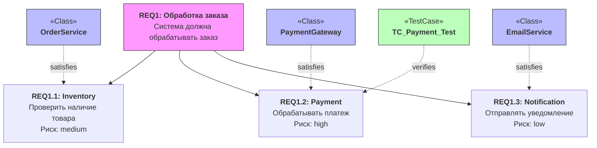
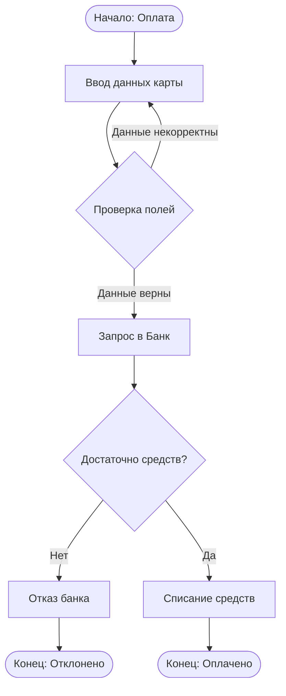
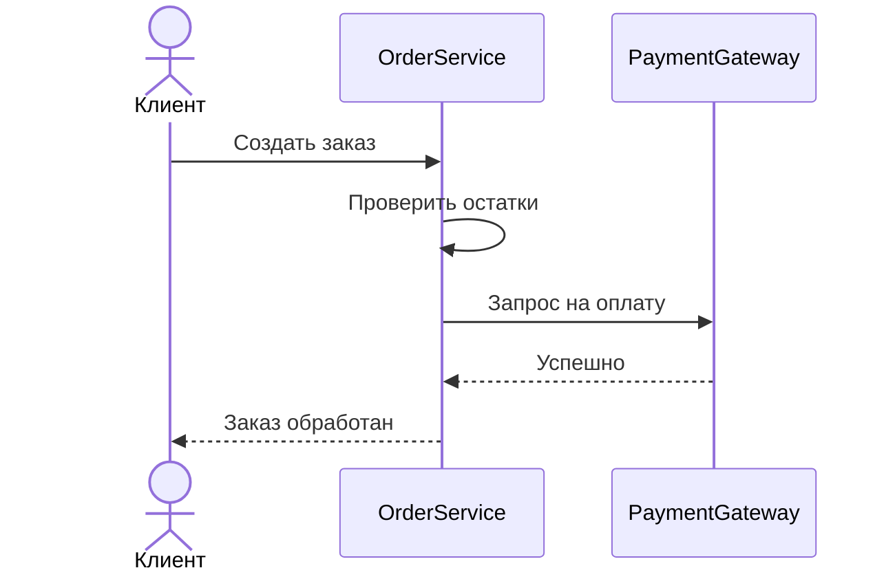
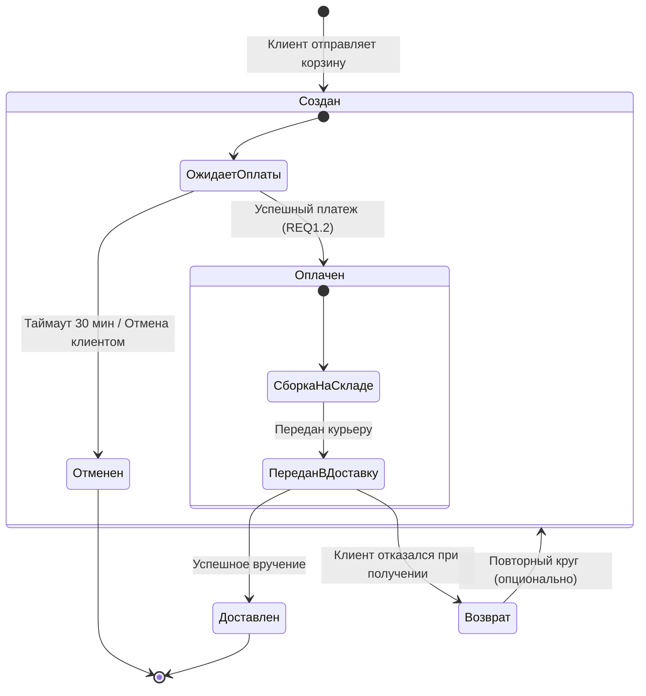

# Архитектурное описание системы обработки заказов (Order Processing System)

Данный документ содержит техническую спецификацию и архитектурные диаграммы системы. Все диаграммы интерактивны и рендерятся нативно средствами GitHub.

---

## 1. Спецификация требований (Requirement Diagram)

---

## 2. Границы системы и прецеденты (Use Case Diagram)

---

## 3. Бизнес-процесс обработки платежа (Activity Diagram)

---

## 4. Динамическое взаимодействие компонентов (Sequence Diagram)

---

## 5. Жизненный цикл заказа (State Machine Diagram)

Диаграмма состояний описывает внутреннее поведение сущности «Заказ», правила смены статусов и возможные триггеры переходов.

## 6. Метод валидации номера банковской карты по алгоритму Луна (Luhn Algorithm) (Activity Diagram)
'''mermaid
flowchart TD
    Start([Вход: string cardNumber]) --> Clear[1. Удалить пробелы и дефисы из строки]
    Clear --> CheckDigits{2. Строка состоит только из цифр?}
    
    CheckDigits -->|Нет| RetFalse1[Возврат: false]
    
    CheckDigits -->|Да| InitVars[3. Инициализировать variables: int sum = 0 bool alternate = false]
    InitVars --> LoopStart[4. Цикл с конца строки: int i = cardNumber.Length - 1]
    
    LoopStart --> LoopCheck{i >= 0 ?}
    
    LoopCheck -->|Нет / Цикл завершен| FinalCheck{5. sum % 10 == 0 ?}
    FinalCheck -->|Да| RetTrue([Возврат: true])
    FinalCheck -->|Нет| RetFalse2([Возврат: false])
    
    LoopCheck -->|Да / Итерация| GetDigit[6. Перевести символ в цифру: int n = cardNumber[i] - '0']
    GetDigit --> CheckAlt{7. Переменная alternate == true?}
    
    CheckAlt -->|Да| Multiply[8. Умножить цифру на 2: n = n * 2]
    Multiply --> CheckNine{9. n > 9 ?}
    CheckNine -->|Да| Subtract[10. n = n - 9]
    CheckNine -->|Нет| ToggleAlt
    Subtract --> ToggleAlt
    
    CheckAlt -->|Нет| ToggleAlt[11. Прибавить к общей сумме: sum = sum + n]
    ToggleAlt --> NextIter[12. Инвертировать флаг: alternate = !alternate]
    
    NextIter --> Decrement[13. i = i - 1]
    Decrement --> LoopCheck

    style CheckDigits fill:#fff2cc,stroke:#d6b656
    style LoopCheck fill:#fff2cc,stroke:#d6b656
    style CheckAlt fill:#fff2cc,stroke:#d6b656
    style CheckNine fill:#fff2cc,stroke:#d6b656
    style FinalCheck fill:#fff2cc,stroke:#d6b656
    style RetFalse1 fill:#f8cecc,stroke:#b85450
    style RetFalse2 fill:#f8cecc,stroke:#b85450
    style RetTrue fill:#d5e8d4,stroke:#82b366
'''
